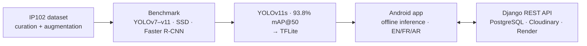

<h1 align="center">Hi, I'm Mahdi Bedja 👋</h1>

<b>AI Engineer</b> · Computer Vision · Speech Recognition · LLMs & Agentic RAG · Edge AI

  
  
  

---

I'm an AI engineer in **Paris**. I graduated as an engineer from **ESI Algiers** and am now doing a **Master 2 in Intelligent Systems at Sorbonne Paris Nord**. I take models from research to production.

- 🏥 **10 months at BM TECH** building AI for hospitals and medical labs:
  - chest X-ray detection of 14 lung pathologies
  - French medical ASR (fine-tuned Whisper, **3% WER**)
  - real-time streaming dictation (**8% WER live**)
  - an Agentic RAG assistant over patient records with local Qwen models
- 🌾 **Thesis:** an offline mobile pest detector. I benchmarked 8 detectors and shipped YOLOv11s (**93.8% mAP@50**) in TFLite on Android.
- 🎯 **Looking for a final-year internship (PFE) in applied AI from March 1, 2027.**

## ⭐ Featured project: Mobile Agricultural Pest Detection

| Repository | What's inside |
| --- | --- |
| [**pest-detection-system**](https://github.com/MehdiBedja/pest-detection-system) | System overview |
| [**pest-detection-computer-vision**](https://github.com/MehdiBedja/pest-detection-computer-vision) | Dataset engineering, 8-model benchmark, TFLite export |
| [**pest-detection-android**](https://github.com/MehdiBedja/pest-detection-android) | Kotlin + Jetpack Compose app, on-device YOLO, Room, sync |
| [**pest-detection-api**](https://github.com/MehdiBedja/pest-detection-api) | Django REST API with offline-first sync and a tested API |

## 🧰 More projects

| Project | Stack |
| --- | --- |
| [**event-ticketing-postgres**](https://github.com/MehdiBedja/event-ticketing-postgres): event ticketing database with PL/pgSQL functions, Flyway and Jenkins CI/CD, plus SQL tests | PostgreSQL · Flyway · Jenkins |
| [**Reservation-app**](https://github.com/MehdiBedja/parking-reservation-api): parking reservation API + [Android client](https://github.com/MehdiBedja/parking-reservation-android) | Django REST · Kotlin · Compose |
| [**docx-certificate-generator**](https://github.com/MehdiBedja/docx-certificate-generator): generates one Word certificate per person from a list | Python · python-docx · Tkinter |
| [**ml-zoomcamp**](https://github.com/MehdiBedja/ml-zoomcamp): ML Zoomcamp coursework | Python · scikit-learn · Jupyter |

## 🛠️ Tech

**GenAI & LLMs:** Agentic RAG · LangChain · LLM agents · local LLM inference (Qwen) · dense embeddings
**Speech & vision:** Whisper fine-tuning & streaming · ASR/TTS · YOLO · SSD · Faster R-CNN · segmentation
**ML:** PyTorch · TensorFlow · Keras · Hugging Face · TFLite · spaCy · OpenCV
**Backend & mobile:** Python · Django REST · PostgreSQL · Elasticsearch · Kotlin · Jetpack Compose
**MLOps:** Docker · Jenkins / GitHub Actions · structured logging · monitoring · Render

  
  
  
  
  
  
  
  
  

## 🌍 Languages

English C1 (IELTS 7.5) · French C1 (TCF C1) · Arabic (native)
